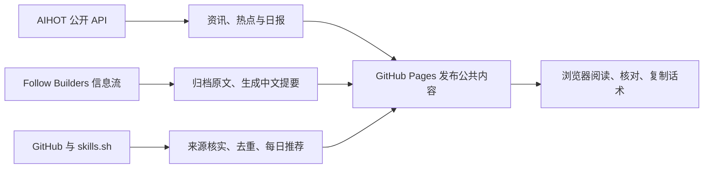

# Alogs

**跟进 AI 动态，读懂作者观点，发现值得试的项目和 Skill。**

[打开网页](https://maxine0917.github.io/Alogs/) · [三个功能](#三个功能) · [使用方式](#怎么使用) · [自行部署](#自行部署)

Alogs 是一个中文 AI 信息与工具发现网站，整合 AIHOT 的资讯、Follow Builders 的作者原帖与播客，以及 GitHub 上的项目和 Skills。

你可以用它了解最近发生了什么，看看做研究、做产品的人如何理解这些变化，也可以单独寻找能用进工作的工具。三个模块分别回答不同的问题，在同一个页面切换和阅读。

直接打开网页就能使用。公共内容在云端更新，不需要安装或运行本地服务。

## 为什么做 Alogs

跟进 AI，往往要在几个地方来回切换。资讯很多，同一件事可能被反复报道；作者的判断散在原帖和长篇访谈里；新工具出现在榜单、精选目录和独立仓库中，看过名字之后，还要弄清它能做什么、怎样安装。

这些内容都值得看，但用途不同。Alogs 把它们放在一起，保留各自的阅读方式：

| 想了解什么 | 在哪里看 | 可以拿来做什么 |
|---|---|---|
| AI 最近发生了什么，哪些事件值得继续看？ | **AI-HOT** | 跟进动态、阅读精选、查看热点和正式日报 |
| 做 AI 的人最近在想什么、尝试什么？ | **Follow Builders** | 阅读作者原帖和访谈，从中文提要继续核对原文 |
| 最近发现了哪些项目和 Skill，能帮我完成什么工作？ | **GitHub 发现** | 查看新增推荐与内容更新，判断用途，再选择工具试用 |

## 三个功能

### AI-HOT：最近发生了什么

同一场发布，官网、媒体和社交平台可能各写一遍。跟进动态时，需要先弄清发生了什么，再决定哪些消息值得读原文。

Alogs 接入 [AIHOT](https://aihot.news) 已整理的资讯与事件，提供三种阅读方式：

- **动态**：查看全部资讯或精选，按日期、分类和关键词查找内容，保留来源链接与发布时间。
- **热点**：查看 AIHOT 已聚合的热门事件和相关来源，围绕一件事了解不同报道。
- **当日提要**：阅读 AIHOT 的正式日报，集中回顾要闻；日报日期与统计区间分别展示。

资讯筛选、中文标题摘要和事件聚合由 AIHOT 上游完成。Alogs 展示这些结果，读者可以随时打开来源核对细节。

### Follow Builders：做 AI 的人怎么看、怎么做

新闻告诉你发生了什么。想进一步理解产品与技术，还需要看看做研究、做产品的人如何判断、实践，以及他们遇到了什么问题。

[Follow Builders](https://github.com/zarazhangrui/follow-builders) 关注研究者、创始人、产品经理和工程师的原帖与访谈。Alogs 接入它维护的公开信息流，整理成适合中文阅读的内容：

- **作者原帖**：按作者与日期查看内容，保留作者姓名与账号、发布时间和原始链接。
- **中文提要**：依据作者当天的原帖整理标题与摘要，先了解主要内容，再按需展开原帖核对。
- **播客**：阅读中文摘要和核心要点；有逐字稿的访谈可以继续展开阅读，也保留节目来源。

这里关注的是作者自己的表达。提要保留观点归因，原帖与访谈仍可查看，方便读者判断作者的依据和适用条件。

### GitHub 发现：最近有什么项目和 Skill 值得试

想用新工具改进工作，需要先了解近期有哪些值得关注的项目和 Skill，再判断它们能解决什么具体问题。同一个工具可能反复上榜，也可能被多个精选目录收录，重复曝光容易掩盖真正的新增内容。

Alogs 从 GitHub Trending 周榜、精选目录更新和 skills.sh 的 24 小时热门榜发现候选，记录新增收录与检测到的内容变化，合并跨来源的重复条目：

- **发现近期内容**：查看新收录的项目和 Skill，以及已收录条目的内容更新；连续上榜或热度数字变化不会重复推荐。
- **了解具体用途**：查看用途说明、原始来源和真实来源仓库的 Star，判断它能替你省下哪些重复步骤，或补充哪些现有工具没有的能力。
- **开始试用**：查看官方说明，复制安装话术交给自己的 AI 工具，先检查环境，再安装或启动。

项目是有独立源码仓库、可以安装或运行的工具、应用和框架；Skill 是供 Agent 复用的任务说明与资源。两类内容分开展示，每天各推荐最多 5 条，超额顺延，不足时少推。

这里的“新”指 Alogs 新增收录或检测到内容变化后发布的推荐，**不等于仓库最近创建**。这个入口用来发现近期值得关注的工具；是否适合产品调研、资料处理、办公自动化或开发辅助，需要结合自己的任务、用途说明和实际试用判断。

## 为什么这样设计

三个模块共用阅读日期，默认打开最近有内容的日期，方便在同一时间范围内切换、搜索和对照。阅读时支持筛选、收藏和浅色／深色模式。目前，新闻、作者观点和项目之间不会自动关联。

中文提要用于判断是否值得继续读，原帖、逐字稿与来源链接用于核对。工具推荐控制每日数量，保留用途、来源和安装入口，方便读者选出要试的内容，而不是再次积累一份待办清单。

Star 用于候选排序，但热度不能证明工具适合你的任务。Skill 展示的是整个来源仓库的 Star，也不能当作单个 Skill 的质量评分。

## 怎么使用

先在 AI-HOT 看资讯、热点或当日提要。遇到想进一步了解的消息，打开来源链接，核对原文中的细节。

想看作者怎样解释这些变化，可以切换到 Follow Builders。先读中文提要，需要时再展开原帖或播客逐字稿，核对作者的原始表达。值得再看的内容可以收藏。

在 GitHub 发现中找到想试的项目或 Skill，先看用途和来源，再复制安装话术，粘贴到自己的 AI 工具中。话术要求 AI 工具先读官方说明、检查环境，再安装或启动。安装后，你可以继续说明要完成的具体任务。复制话术不会执行安装。

## GitHub 推荐怎样产生

项目来自 GitHub Trending 周榜和精选目录，Skills 来自周榜仓库中的实际技能文件和 skills.sh 的 24 小时热门榜。精选目录用于发现条目，评价热度时则核对条目的真实来源。

| 规则 | 具体含义 |
|---|---|
| 来源门槛 | 项目与 Skill 的真实来源仓库都必须达到 1,000 Star |
| 项目定义 | 有独立源码仓库、实际程序代码及构建或安装入口；排除 Awesome 索引、纯 Skill 合集和教程子目录 |
| Skill 定义 | 核实名称、用途与实际 `SKILL.md`；来源未归档；默认排除 `anthropics/skills`，周榜采集另排除明确的仓库内部维护流程 |
| 安装量 | skills.sh 候选还需满足近 24 小时至少 100 次安装；没有这个指标的来源不编造数据 |
| 排序 | 先比较真实来源的累计 Star，再比较安装量；仍相同时，优先发布等待更久的候选 |
| 每日名额 | 每天最多 5 个项目、5 个 Skills，新增和内容更新共用名额；超额顺延，不足时少推 |
| 去重 | 同一链接或可核实的相同 Skill 正文合并；连续上榜、Star 和安装量变化不重复推荐 |
| 历史 | 不符合现行规则的旧记录保留在历史与收藏中，不再占用有效推荐名额 |

收录日期是 Alogs 发布或更新推荐的日期，不是仓库创建日期。核实项目的源码和安装入口，也不代表它已经在你的环境中安装验证。

来源和门槛见 [`sources.json`](sources.json)；来源核实、去重和每日名额的实现见 [`scripts/sync_github.py`](scripts/sync_github.py) 与 [`scripts/source_metrics.py`](scripts/source_metrics.py)。

## 内容怎样更新



GitHub Actions 在云端采集和发布内容，你的电脑可以关闭。所有访客读取同一份公共内容。

| 内容 | 检查或同步时间 |
|---|---|
| 资讯、热门话题、日报与作者信息流 | 每 5 分钟安排一次检查 |
| GitHub 项目与 Skills | 每天北京时间 08:00 之后第一次运行时同步；任务延迟时顺延 |
| 已打开的网页 | 每分钟检查数据版本，有变化时读取新内容；点击“刷新”可立即读取最新发布结果 |

每 5 分钟检查一次，不代表新内容一定能在 5 分钟内显示。上游可能没有更新，Actions 可能排队，采集和 Pages 发布也需要时间。刷新读取的是已发布的结果；阅读、刷新和收藏都不会触发模型调用。中文提要按原文的内容指纹缓存，原文变化后才重新生成。

作者原帖按作者和日期归档，模型依据原文生成中文提要；有逐字稿的播客也会生成摘要和核心要点。提要注明观点来自谁，不补写原文没有的信息。新闻的精选、标题摘要和事件聚合由 AIHOT 上游提供。

Actions artifacts 保存和恢复去重游标、候选队列、每日推荐账本和摘要缓存，保留最近 3 份状态及 2 份网站发布产物。`seed/*.json.gz` 是首次上线的公开数据快照，不含密钥。后续任务如果无法恢复状态，会停止运行，避免在没有提示的情况下重置每日名额。

公开仓库长期没有活动时，GitHub 可能停用定时任务，可在 Actions 中手动重新启用。这套方案适合定时更新的信息网站，不保证严格的实时更新时限。

## 自行部署

1. 创建自己的公开仓库并上传源码。
2. 在仓库 Settings → Pages 选择 **GitHub Actions**。
3. 在 Actions secrets 配置 `LLM_BASE_URL`、`LLM_API_KEY`、`LLM_MODEL`；可选 `LLM_EXTRA_JSON`、`LLM_REASONING_TOKENS`。模型请求使用 OpenAI 兼容接口，需支持 JSON 输出及代码中的推理配置，详见 [`scripts/content_service.py`](scripts/content_service.py)。
4. 运行 **Sync and publish Alogs**。首次创建状态，随后自动恢复。

如果不需要生成新的中文提要，将 workflow 的 `MODEL_CALLS_ENABLED` 改为 `false`。已有提要和原帖仍可阅读，资讯也会继续接入 AIHOT 的上游整理结果。

### 本地预览与验证

需要 Python 3.12，GitHub 采集另需要已认证的 `gh`。

```sh
python -m unittest discover -s tests -v
python scripts/state.py seed
python -c "import sys; sys.path.insert(0, 'scripts'); from cloud_sync import publish_manifest; publish_manifest()"
python -m http.server 8080 --directory site
```

打开 http://localhost:8080 。这里预览的是云端页面的静态版本，刷新会读取本地的公开数据文件。

## 目录

| 路径 | 内容 |
|---|---|
| [`site/`](site/) | 公开页面、阅读交互和初始内容 |
| [`scripts/`](scripts/) | 上游读取、中文提要、来源核实、去重、状态恢复与发布 |
| [`sources.json`](sources.json) | GitHub 来源、收录门槛及用途整理配置 |
| [`seed/`](seed/) | 首次上线的公开数据快照 |
| [`.github/workflows/publish.yml`](.github/workflows/publish.yml) | 云端定时更新与 Pages 发布 |

## 数据来源与隐私

- 资讯、精选、热门事件和正式日报来自 [AIHOT](https://aihot.news)。
- 作者原帖与播客来自 [Follow Builders](https://github.com/zarazhangrui/follow-builders) 的公开信息流。能读到多少历史内容，取决于上游提供的内容和 Alogs 后续成功归档的记录。
- 工具与 Skills 来自 GitHub、精选目录及 [skills.sh](https://skills.sh)，保留收录来源和原始出处。

README 的功能叙述参考了 [AIHOT 开源项目](https://github.com/Maxine0917/AIHOT) 与 [Follow Builders](https://github.com/zarazhangrui/follow-builders)。Alogs 接入的是上游公开内容；当前提供网页阅读与工具发现，上游项目的后台、消息推送和对话配置能力不属于本页功能。

收藏和外观偏好保存在各自浏览器，不跨设备同步。模型密钥只进入 Actions 环境，不进入网页、数据产物或 Git 提交。

同步日志与状态产物在公开仓库可见，仅保存公开上游数据和中文整理结果。文章、原帖和播客的版权属于各原作者；请通过来源链接核对和继续阅读。

字体 Instrument Sans 的许可证在 [`site/_shared/fonts/InstrumentSans-OFL.txt`](site/_shared/fonts/InstrumentSans-OFL.txt)。
